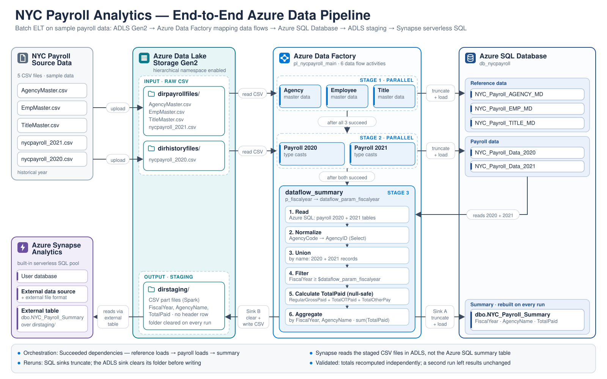
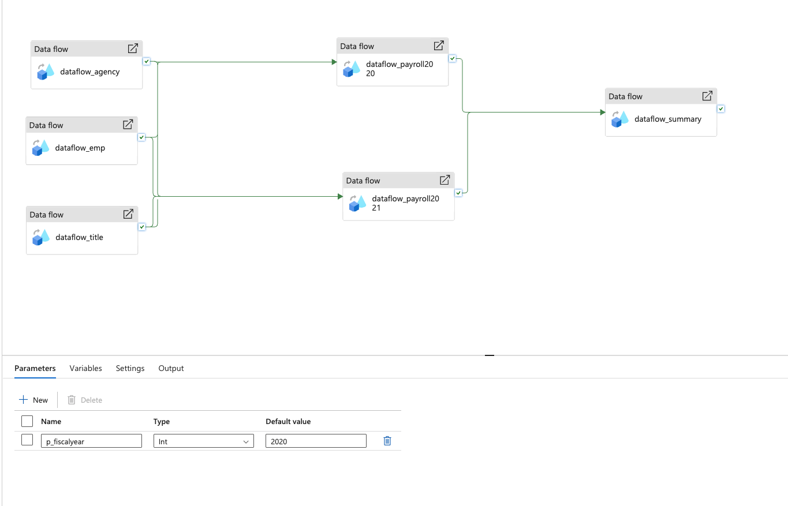
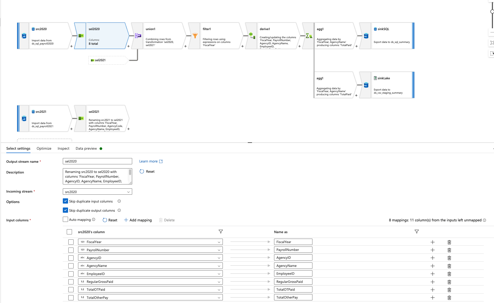
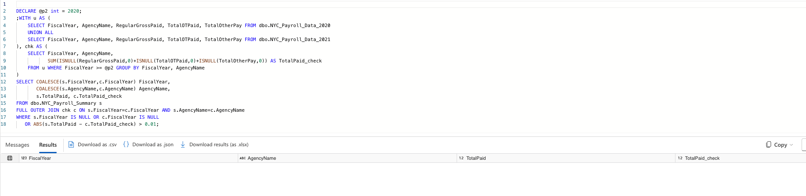

# NYC Payroll Analytics | Azure Data Engineering Pipeline

An end-to-end Azure data engineering pipeline that ingests NYC payroll datasets, harmonizes records from two fiscal years with different schemas, computes agency-level payroll totals, and makes the results queryable through both Azure SQL Database and Azure Synapse serverless SQL.

**Use case:** summarize payroll spending by agency and fiscal year, including overtime and other pay, from files whose schemas differ between years, and publish the result for SQL analysis.

**Stack:** Azure Data Factory (pipelines, mapping data flows) · Azure Data Lake Storage Gen2 · Azure SQL Database (T-SQL) · Azure Synapse Analytics (built-in serverless SQL pool, external tables) · Git integration with GitHub

> **Scope note.** This was built and validated in a temporary Azure lab environment on small **sample** files (100 payroll rows per year). It is not a production system and was not deployed for or used by New York City. See [Limitations](#limitations).

## What this project demonstrates

- **Validation, not just execution.** Pipeline success was not treated as proof of correctness. Results were reconciled independently three ways: recomputed from the source SQL tables, recomputed from the raw CSV files outside Azure, and queried again through Synapse. All matched: zero discrepancies, zero duplicate keys.
- **Rerun consistency.** The pipeline was executed twice. Row counts, summary values, and Synapse results were identical after the second run, and the staging folder was fully replaced rather than appended to.
- **Dependency-based orchestration.** Three reference-data loads run in parallel, both payroll loads wait for all three, and the summary waits for both payroll loads. Run timestamps from Azure Monitor confirm this order.
- **Schema harmonization and null-safe finance logic.** 2020 and 2021 use different agency identifier columns (`AgencyID` / `AgencyCode`); both are normalized before a union. `TotalPaid` handles nulls explicitly and keeps negative adjustments.

## Solution Architecture

[](docs/images/architecture.svg)

*Click the diagram to open it full-size (the text is small on narrow screens). Editable source: [docs/architecture.drawio](docs/architecture.drawio) (open in diagrams.net). Exported images: [SVG](docs/images/architecture.svg), [PNG](docs/images/architecture.png).*

**In words:** source CSV files land in ADLS Gen2; Azure Data Factory loads three reference tables in parallel, then two payroll tables in parallel, into Azure SQL Database; a summary data flow reads both payroll tables and writes the aggregate to an Azure SQL table and to CSV files in `dirstaging/`.

Synapse reads the staged CSV files in ADLS `dirstaging/` through a serverless external table. It does not read the Azure SQL summary table; the two sinks are independent copies of the same aggregate, which is what made cross-service validation meaningful.

## Pipeline Orchestration



*Pipeline `pl_nycpayroll_main` in the ADF authoring canvas: six Execute Data Flow activities and one pipeline parameter, `p_fiscalyear` (int, default 2020).*

The pipeline runs six mapping data flows: five ingestion flows (three reference loads and two payroll loads) and one summary flow.

- `dataflow_agency`, `dataflow_emp`, and `dataflow_title` have no dependencies and run in parallel.
- `dataflow_payroll2020` and `dataflow_payroll2021` each depend on all three reference loads (`Succeeded`), then run in parallel.
- `dataflow_summary` depends on both payroll loads (`Succeeded`) and receives `p_fiscalyear` as `dataflow_param_fiscalyear`.

The dependency graph can be checked directly in [pipeline/pl_nycpayroll_main.json](pipeline/pl_nycpayroll_main.json) (`dependsOn`).

## Data Transformation



*`dataflow_summary`: two SQL sources, a Select per year, union, filter, derived column, aggregate, and two sinks.*

| Step | What it does | Why it matters |
|---|---|---|
| Read | Reads `NYC_Payroll_Data_2020` and `NYC_Payroll_Data_2021` from Azure SQL | The summary is built from loaded, typed tables rather than raw text files |
| Normalize | `Select` keeps the 8 needed columns and maps `AgencyCode` to `AgencyID` for 2021 | Union by name would otherwise produce two half-empty agency columns |
| Union | `union(byName: true)` of both years | Combines historical and current records into one stream |
| Filter | `toInteger(FiscalYear) >= $dataflow_param_fiscalyear` | One data flow serves any cutoff year; also removes stray out-of-range rows in the sample files |
| Calculate | `TotalPaid = coalesce(toDouble(RegularGrossPaid),0) + coalesce(toDouble(TotalOTPaid),0) + coalesce(toDouble(TotalOtherPay),0)` | A null component cannot wipe out the other two; negative adjustments are kept |
| Aggregate | Group by `FiscalYear`, `AgencyName`; `sum(TotalPaid)` | Produces the agency-level summary |
| Sinks | Azure SQL `dbo.NYC_Payroll_Summary` (truncate) and ADLS `dirstaging/` (clear folder) | Same result in a relational table and in files, so each can validate the other |

Full expressions and settings: [docs/dataflow-expressions.md](docs/dataflow-expressions.md).

## Execution & Validation

All results below were observed in the lab run and are recorded in [docs/verification_results.md](docs/verification_results.md). The source files are samples, so the figures describe this dataset only.

| Check | Result |
|---|---|
| ADF pipeline run (`p_fiscalyear = 2020`) | 6 of 6 activities succeeded |
| Loaded rows vs source files | Agency 153 · Employee 1,000 · Title 1,446 · Payroll 2020: 100 · Payroll 2021: 101 (all equal to the CSV row counts) |
| Summary rows | 25 (2 for FiscalYear 2020, 23 for 2021); sample total 35,709,510.43 |
| Reconciliation, SQL | Summary vs independent recomputation from the source tables: 0 differing rows |
| Reconciliation, CSV | Summary vs totals computed from the raw CSV files by a separate script: 0 differences above 0.01 |
| Quality checks | 0 null cells, 0 duplicate (`FiscalYear`, `AgencyName`) keys, 0 negative totals, 0 duplicate source keys |
| Synapse serverless | External table returns the same 25 rows and the same total |
| Second run | Identical counts, totals, and Synapse results; `dirstaging` files fully replaced |

**Independent reconciliation** (SQL `FULL OUTER JOIN` of the pipeline output against a fresh aggregation of the source tables; an empty result means no discrepancies):



### More evidence

| Evidence | What it shows | File |
|---|---|---|
| First pipeline run | Azure Monitor view of the six successful activities with start times | [09_pipeline_run_success.png](evidence/screenshots/09_pipeline_run_success.png) |
| Second pipeline run | All six activities succeeded again, in the same dependency order | [09c_rerun_success.png](evidence/screenshots/09c_rerun_success.png) |
| Synapse serverless query | The external table over `dirstaging/` returns the 25 summary rows | [12_synapse_query.png](evidence/screenshots/12_synapse_query.png), after the rerun: [12c_synapse_after_rerun.png](evidence/screenshots/12c_synapse_after_rerun.png) |
| Staging folder after the rerun | The same 25 objects, all with new names and timestamps: the previous run's files were cleared, not accumulated | [11c_dirstaging_after_rerun.png](evidence/screenshots/11c_dirstaging_after_rerun.png) |
| Row counts after the run | The five loaded tables against the source file row counts | [10a_sql_row_counts.png](evidence/screenshots/10a_sql_row_counts.png) |
| Quality checks | Null cells, duplicate keys, negative totals, source duplicates | [10d](evidence/screenshots/10d_quality_null_cells.png), [10e](evidence/screenshots/10e_quality_duplicate_keys.png), [10f](evidence/screenshots/10f_quality_negative_totals.png), [10i](evidence/screenshots/10i_source_duplicate_check.png) |
| Overtime totals | `TotalOTPaid` and `OTHours` by fiscal year in the source tables | [10h_overtime_by_year.png](evidence/screenshots/10h_overtime_by_year.png) |
| Raw result exports | Summary, activity runs, and Synapse output as CSV | [evidence/](evidence/) |

The full index of screenshots and result files is in [docs/validation-and-evidence.md](docs/validation-and-evidence.md).

## Engineering Decisions

**1. Validation was designed in, and it caught the class of error that matters.** With null-safe arithmetic, a column that is accidentally missing upstream becomes `0` instead of an error. During development a Select for 2020 that omitted `TotalOTPaid` was found in review before the first run; it would have understated 2020 overtime without any failure. That is why correctness rests on independent recomputation and cross-service comparison rather than on activity status.

**2. Schema differences between years.** The 2020 file uses `AgencyID`; the 2021 file uses `AgencyCode`. Each source keeps its own table schema; the summary flow renames `AgencyCode` to `AgencyID` in a Select and unions by name, so the combined stream has one consistent agency identifier.

**3. Dependency-based orchestration.** Payroll ingestion starts only after the three reference loads succeed, and the summary starts only after both payroll loads succeed. Independent loads run in parallel; a failed predecessor stops everything downstream instead of producing a summary from partial data.

**4. Parameterized processing.** `p_fiscalyear` flows from the pipeline into `dataflow_param_fiscalyear`, which drives the filter. The pipeline was executed with 2020 only; other values were not run in Azure. The expected 2021 output (23 rows) was computed locally from the CSVs and is stored in [docs/expected_summary_param2021_LOCAL.csv](docs/expected_summary_param2021_LOCAL.csv); it was not observed in Azure.

**5. Financial accuracy.** Nulls are handled with `coalesce`; negative adjustments (6 rows in the samples) are deliberately preserved so totals are net pay; amounts are reconciled to within 0.01. The source DDL uses `FLOAT`, which is why summed values show floating-point noise such as `35709510.43000001`; a production design would use `DECIMAL` for money.

**6. Rerun reliability.** SQL sinks use *Truncate table* and the ADLS sink uses *Clear the folder*, so every run rebuilds its outputs from the source tables. This suits a small batch-rebuild design and was verified by the second run. It would not suit an incremental or large-scale workload, where upserts or partition overwrites would be needed.

**7. Serverless analytics.** Synapse serverless SQL queries the staged files in place through an external data source, file format, and external table (`LOCATION = 'dirstaging/'`). No dedicated pool or data copy is needed, and the table reads whatever part files the pipeline wrote (the pipeline writes several small Spark part files, so no file name is hard-coded).

## Repository Structure

```
.
├── README.md
├── factory/            ADF factory definition            (ADF Git integration)
├── pipeline/           pl_nycpayroll_main                 (ADF Git integration)
├── dataflow/           5 ingestion flows + dataflow_summary (ADF Git integration)
├── dataset/            6 DelimitedText + 6 Azure SQL datasets (ADF Git integration)
├── linkedService/      ADLS Gen2 and Azure SQL linked services (ADF Git integration)
├── sql/
│   ├── azure_sql/      table DDL, validation queries
│   └── synapse/        serverless external table script
├── sample-data/        synthetic example input files and expected results
├── docs/
│   ├── architecture.drawio, images/    editable diagram and exports
│   ├── dataflow-expressions.md         data flow design reference
│   ├── verification_results.md         recorded results
│   ├── validation-and-evidence.md      requirements-to-evidence index
│   ├── portfolio-summary.md            short case-study summary
│   └── expected_summary_param*_LOCAL.csv  expected results computed from the CSVs
└── evidence/           screenshots and exported result files
```

The ADF-managed folders are exports from Azure Data Factory Git integration and are unchanged.

## Reproducing the Pipeline

The original Azure resources were temporary and no longer exist. This is a manual rebuild guide; there is no infrastructure-as-code or one-click deployment. Azure services incur charges, so review current pricing first.

**Prerequisites:** an Azure subscription; permission to create a storage account (hierarchical namespace enabled), an Azure SQL Database, a Data Factory, and a Synapse workspace; the five input CSV files described below.

### Input data

The pipeline expects five UTF-8, comma-delimited CSV files with a header row:

| File | Columns | Upload to |
|---|---|---|
| `AgencyMaster.csv` | `AgencyID`, `AgencyName` | `dirpayrollfiles/` |
| `EmpMaster.csv` | `EmployeeID`, `LastName`, `FirstName` | `dirpayrollfiles/` |
| `TitleMaster.csv` | `TitleCode`, `TitleDescription` | `dirpayrollfiles/` |
| `nycpayroll_2021.csv` | 19 payroll columns; agency column named `AgencyCode` | `dirpayrollfiles/` |
| `nycpayroll_2020.csv` | the same 19 columns; agency column named `AgencyID` | `dirhistoryfiles/` |

The 19 payroll columns are listed in [sample-data/README.md](sample-data/README.md); dates use `M/d/yyyy`.

**Where to get them**

- **Original sample files (used for the verified results).** Distributed as one ZIP by the data-engineering training program this project was based on: [data-nyc-payroll.zip](https://video.udacity-data.com/topher/2022/May/6283aff5_data-nyc-payroll/data-nyc-payroll.zip). The link responded with HTTP 200 and a 33,785-byte ZIP when checked on 2026-11-17; the archive was not downloaded or inspected for this check. It is hosted by a third party, availability is not guaranteed, and the files are not redistributed in this repository.
- **NYC Open Data (related, but not identical).** The City publishes [Citywide Payroll Data (Fiscal Year)](https://data.cityofnewyork.us/City-Government/Citywide-Payroll-Data-Fiscal-Year-/k397-673e) through the Office of Payroll Administration. At the time of checking it exposes 17 columns and **has no `EmployeeID`, `TitleCode`, or agency-code column**, so it cannot recreate the master files or the exact payroll files without additional keys and schema mapping. A spot check of one salary and pay combination (non-personal fields only) found matching public records, so the sample rows appear to come from this dataset, but they were not verified as exact extracts. Review the portal's terms of use before reusing the data.
- **Synthetic example (included).** [sample-data/](sample-data/) holds five tiny fictional files with the expected schemas, both the `AgencyID` and `AgencyCode` variants, and locally computed expected results. It is meant for running the pipeline end to end, not for reproducing the original figures.

**What to change to reproduce the workflow**

1. Upload the files to the folders above in your own container.
2. In the linked services and datasets, replace the storage account, container, SQL server, and database names.
3. In the Synapse script, replace `<STORAGE_ACCOUNT>` and `<CONTAINER>`.
4. Compare your results with the files that match the data you used.

**Why results may differ.** Row counts, number of agencies, totals, and the out-of-range rows depend entirely on the input files. Any dataset other than the original sample files will produce different totals than the 25 rows and 35,709,510.43 recorded here; the pipeline logic and checks, not the numbers, are what carry over.

### Deployment steps

1. **Storage.** Create an ADLS Gen2 account and a container with folders `dirpayrollfiles/` (four master/2021 files), `dirhistoryfiles/` (`nycpayroll_2020.csv`), and `dirstaging/` (empty).
2. **Database.** Create an Azure SQL Database and run [sql/azure_sql/01_create_tables.sql](sql/azure_sql/01_create_tables.sql) (six tables). Allow Azure services and your client IP through the server firewall.
3. **Data Factory.** Create linked services for ADLS Gen2 and Azure SQL (JSON in [linkedService/](linkedService/); replace the account/server/database names and re-enter credentials; the committed `encryptedCredential` values only work inside the original factory). For the SQL connector, version 1.0 was used.
4. **Datasets, data flows, pipeline.** Import or recreate the definitions in `dataset/`, `dataflow/`, and `pipeline/`, updating container, account, and server references. Settings are explained in [docs/dataflow-expressions.md](docs/dataflow-expressions.md).
5. **Run.** Publish and trigger `pl_nycpayroll_main` with `p_fiscalyear` (default 2020).
6. **Validate.** Run [sql/azure_sql/02_validation_queries.sql](sql/azure_sql/02_validation_queries.sql) one query at a time, and compare with [docs/verification_results.md](docs/verification_results.md).
7. **Synapse.** In a Synapse workspace, create a user database on the built-in serverless pool, then run [sql/synapse/01_serverless_external_objects.sql](sql/synapse/01_serverless_external_objects.sql) section by section (master key, SAS credential, data source, file format, external table). Supply your own SAS token and password; never commit them.

## Limitations

- **Sample data.** Payroll files contain 100 rows each; all figures describe these samples, not the full NYC payroll dataset. `TotalPaid` is payroll expenditure, not the City's budget, and no budget percentage is claimed.
- **Temporary environment.** The pipeline ran in a time-limited Azure lab sandbox and is not a continuously running service. The source files and the overall target design come from a data-engineering training brief; the implementation, validation, and documentation in this repository are the result of building it.
- **Parameter coverage.** Only `p_fiscalyear = 2020` was executed (twice). No performance, cost, or scale benchmarks were collected.
- **Design trade-offs.** Full rebuilds on every run, `FLOAT` for currency, key- and SAS-based credentials, and no alerting, CI/CD, or infrastructure-as-code. A production version would use managed identities or Key Vault, `DECIMAL` types, incremental loads, and monitoring.
- **Staging dataset metadata.** `ds_csv_staging_summary` still carries an unused 19-column string schema from an earlier schema import. The sink writes the three aggregate columns, as verified by the staged files and the Synapse results; the stale schema is left as exported.

## Documentation & Evidence

| Document | Purpose |
|---|---|
| [docs/verification_results.md](docs/verification_results.md) | Recorded results of the run, reconciliation, rerun, and Synapse checks |
| [docs/validation-and-evidence.md](docs/validation-and-evidence.md) | Source-data profile, requirement-to-evidence matrix, evidence index, troubleshooting |
| [docs/dataflow-expressions.md](docs/dataflow-expressions.md) | Mapping data flow and pipeline design reference |
| [docs/portfolio-summary.md](docs/portfolio-summary.md) | Short case-study summary |
| [sample-data/README.md](sample-data/README.md) | Synthetic example input files and expected results |
| [evidence/screenshots/](evidence/screenshots/) | Execution and validation screenshots |

Screenshots of data previews have the employee ID and name columns redacted; no employee-level source files are included in this repository.

## Security

No keys, passwords, or SAS tokens are stored in this repository; placeholders appear in `<ANGLE_BRACKETS>`. The linked service JSON contains server and database names, a SQL login name, and ADF `encryptedCredential` metadata, but no readable password or account key.
